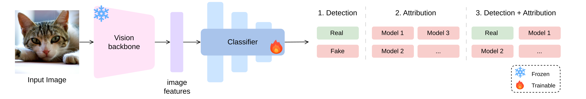

# DejaVu

This repository contains the official code for the paper "Mapping the Landscape of Frozen Pretrained Backbones for Image Forensics" (TMLR 2026). 



Most synthetic image detectors follow a common paradigm, combining a **frozen pretrained backbone** for feature extraction with a **lightweight classifier** for prediction. 
They primarily differ in implementation choiches, including the selection of the backbone, classifier architecture, preprocessing strategy, and evaluation protocol.

In this work, we systematically investigate these detectors across three tasks:

| task | classes |
|---|---|
| `detection` | real vs. synthetic |
| `attribution` | the source generators that produced a synthetic image |
| `detection+attribution` | real vs. the source generators |

**DejaVu** is the best configuration found on the validation set, combining MetaCLIP2-ViT-bigG/14 with a 3-layer MLP.

The pipeline has two stages: features are extracted once per backbone and split (`extract_features.py`), then classifiers are trained and evaluated on them (`train.py`, `evaluate.py`).

## Contents

```
extract_features.py   feature extraction (backbones, preprocessing, layers, post-processing)
train.py              train classifiers on GenImage train, evaluate on any evaluation set (validation or test)
evaluate.py           evaluate trained classifiers (OOD sets, post-processed images)
summarize.py          average the per-run metrics (mean ± std)
dejavu/               library code
data/splits/          split CSVs (image paths, labels, generators, prompts)
configs/              dataset locations
scripts/              one script per experiment of the paper
```

## Installation

```bash
conda create -n dejavu python=3.10 -y && conda activate dejavu
pip install -r requirements.txt 
```

⚠️ DINOv3 weights are gated: accept the license on their HF pages first. Then:

```bash
huggingface-cli login 
```

The paper's experiments ran on NVIDIA RTX 4090 (24 GB) and RTX 5090 (32 GB) GPUs.
DINOv3-ViT-7B/16 in float32 needs ~28 GB of GPU memory; on smaller GPUs use
`--dtype bfloat16` (results may then differ slightly from the paper).

## Datasets Preparation

| dataset key | used for | what to download | download link |
|---|---|---|---|
| `GenImage` | training, in-domain evaluation (fake) | GenImage, evaluation partition (`<generator>/.../val/ai`) of the 8 generators | https://github.com/GenImage-Dataset/GenImage |
| `ImageNet` | training, in-domain evaluation (real) | ILSVRC2012 validation images (`ILSVRC2012_val_XXXXXXXX.JPEG`) | https://huggingface.co/datasets/ILSVRC/imagenet-1k |
| `Synthbuster` | OOD | Synthbuster (9 diffusion generators) | https://zenodo.org/records/10066460?preview_file=synthbuster.zip |
| `RAISE` | OOD (real images of Synthbuster) | RAISE-1k (`r*.TIF`) | https://loki.disi.unitn.it/RAISE/download.html |
| `AIGIBench` | OOD | AIGIBench test set (`test/<subset>/{0_real,1_fake}`) | https://huggingface.co/datasets/HorizonTEL/AIGIBench | 
| `CO-SPY` | OOD | CO-SPY-Bench (`Co-Spy-Bench/{real_image_examples,synthetic}`); we use a portion of the CC3M, SBU and TextCaps subsets | https://github.com/Megum1/CO-SPY |
| `CommunityForensics` | OOD | Community Forensics evaluation set | https://huggingface.co/datasets/OwensLab/CommunityForensics-Eval |

Within `configs/data_paths.yaml`, set the root of each dataset (or a single `data_root` with one sub-folder per key) and, if your GenImage copy is not organized as the official release, the per-generator folders under `genimage_layout`.

### Splits (`data/splits/`)

Paths in the CSVs are relative (`<dataset key>/...`), so features and results do not
depend on where the data is stored.

| split | images | notes |
|---|---|---|
| `genimage_train` | 79,950 (39,950 real) | 800 ImageNet classes ("prompts") |
| `genimage_validation` | 10,050 (5,050 real) | 100 other classes; all design choices are made here |
| `genimage_test` | 10,000 (5,000 real) | 100 other classes |
| `{synthbuster,aigibench,cospy,communityforensics}_{validation,test}` | | OOD benchmarks, split by content, all generators in both halves |
| `ood_attribution_{validation,test}` | 8,312 / 8,181 | OOD images of GLIDE, Midjourney, SDv4, SDv5 (Section 4.2.1) |
| `ood_detection_attribution_{validation,test}` | 73,734 / 73,678 | the same + the real images of the OOD benchmarks (Section 4.3.1) |

GenImage splits are class-disjoint: each prompt appears in one split only. The
`ood_*` splits reuse the features of the four OOD benchmarks, so they need no
extraction of their own.

In training, fake images are JPEG-compressed at QF 96 before feature extraction (the real ImageNet images are JPEGs); the OOD benchmarks are used as distributed. Use `--fake_qf96` to change this.

## Usage

All commands accept `-h`. The `--backbones` option of `extract_features.py`, `train.py` and `evaluate.py` takes one or more values among:

| value | selects |
|---|---|
| a backbone id, e.g. `MetaCLIP2-ViT-bigG-14` | that backbone (see the table below) |
| a paper name, e.g. `"MetaCLIP2-ViT-bigG/14"` | that backbone (quote names containing `/`) |
| `DejaVu` | `MetaCLIP2-ViT-bigG-14` |
| `clip` | the 9 OpenAI CLIP backbones |
| `metaclip2` | the 4 MetaCLIP 2 backbones |
| `dino` | the 9 DINOv2 and DINOv3 backbones |
| `all` | all 22 backbones |

Values can be combined, e.g. `--backbones clip DINOv3-ViT-7B-16`; duplicates are removed.

| family | id (`--backbones`) | paper name |
|---|---|---|
| `clip` | `ViT-B-32` | ViT-B/32 | 
| `clip` | `ViT-B-16` | ViT-B/16 | 
| `clip` | `ViT-L-14` | ViT-L/14 | 
| `clip` | `ViT-L-14@336px` | ViT-L/14@336px | 
| `clip` | `RN50` | RN50 | 
| `clip` | `RN101` | RN101 | 
| `clip` | `RN50x4` | RN50×4 | 
| `clip` | `RN50x16` | RN50×16 | 
| `clip` | `RN50x64` | RN50×64 | 
| `metaclip2` | `MetaCLIP2-ViT-S-16` | MetaCLIP2-ViT-S/16 | 
| `metaclip2` | `MetaCLIP2-ViT-M-16` | MetaCLIP2-ViT-M/16 |
| `metaclip2` | `MetaCLIP2-ViT-H-14` | MetaCLIP2-ViT-H/14 | 
| `metaclip2` | `MetaCLIP2-ViT-bigG-14` | MetaCLIP2-ViT-bigG/14 (DejaVu) | 
| `dino` | `DINOv2-ViT-S-14` | DINOv2-ViT-S/14 | 
| `dino` | `DINOv2-ViT-B-14` | DINOv2-ViT-B/14 | 
| `dino` | `DINOv2-ViT-L-14` | DINOv2-ViT-L/14 | 
| `dino` | `DINOv2-ViT-g-14` | DINOv2-ViT-g/14 |
| `dino` | `DINOv3-ViT-S-16` | DINOv3-ViT-S/16 | 
| `dino` | `DINOv3-ViT-B-16` | DINOv3-ViT-B/16 |
| `dino` | `DINOv3-ViT-L-16` | DINOv3-ViT-L/16 | 
| `dino` | `DINOv3-ViT-Hplus-16` | DINOv3-ViT-H+/16 | 
| `dino` | `DINOv3-ViT-7B-16` | DINOv3-ViT-7B/16 |

The id is used in feature and output folder names.

### 1. Extract features

```bash
# GenImage train/validation/test and the OOD benchmarks (validation + test), all 22 backbones
python extract_features.py --backbones all --splits genimage ood --data_config configs/data_paths.yaml
```

Features go to `<features_dir>/<backbone>/<split>[__<variant>].pt` (default `features/`). 

Options: `--splits` (`genimage`, `ood`, `ood_validation`, `ood_test` or split names), `--preprocess {default,openai,defake,univfd}`, `--layers block22 ...` or `--all_layers`, one post-processing among `--jpeg QF`, `--blur SIGMA`, `--resize R`, `--crop C`, `--center_crop C`. 
Existing files are skipped unless `--overwrite`.

### 2. Train and evaluate

```bash
# DejaVu on the three tasks, evaluated on GenImage validation and test, in-domain and OOD
python train.py --backbones DejaVu --classifiers 3-MLP \
    --tasks detection attribution detection+attribution --eval_sets genimage ood

# any of the 6 classifiers (or `all`) on any backbone
python train.py --backbones DINOv3-ViT-7B-16 RN50x64 --classifiers LR SVM kNN --tasks attribution

# training-set size: 1 ... 800 prompts (800 = whole training set)
python train.py --backbones all --tasks detection --num_prompts 1 5 10 50 100 300 500 800

# alternative preprocessing: first extract the features with that preprocessing,
# then train/evaluate passing the same --preprocess
python extract_features.py --backbones DejaVu --splits genimage --preprocess defake --data_config configs/data_paths.yaml
python train.py --backbones DejaVu --tasks attribution --preprocess defake

# intermediate layer: first extract the features of that layer (or --all_layers),
# then train/evaluate passing the same --layers
python extract_features.py --backbones DejaVu --splits genimage --layers block28 --data_config configs/data_paths.yaml
python train.py --backbones DejaVu --tasks attribution --layers block28

# cross-model generalization: train on chosen generators (+ all real images)
python train.py --backbones DejaVu --tasks detection --train_generators vqdm wukong --eval_sets genimage
```

Every combination of `--backbones`, `--tasks`, `--classifiers`, `--layers` and `--num_prompts` is trained. MLPs are trained `--runs 10` times; LR/SVM/kNN once, with theirhyper-parameters chosen by 5-fold cross-validation on the training set. 
With `--num_prompts`, each run draws its own random prompts (seed 42 + run), for every classifier. `--eval_sets`: `genimage` (validation + test, the default), `ood`, `ood_validation`, `ood_test` (the OOD sets of each task) or split names.

### 3. Evaluate saved classifiers

```bash
# OOD evaluation of classifiers trained earlier
python evaluate.py --backbones DejaVu --tasks detection attribution detection+attribution --eval_sets ood

# robustness: features of post-processed test images, then evaluation
python extract_features.py --backbones DejaVu --splits genimage_test --jpeg 75 --data_config configs/data_paths.yaml
python evaluate.py --backbones DejaVu --eval_sets genimage_test --jpeg 75
```

The configuration is identified by the same options as in `train.py`
(e.g. `--num_prompts 1`, `--train_generators vqdm wukong`).

### 4. Outputs and summaries

```
<out_dir>/metrics/<task>.csv                 one row per configuration x evaluation set x run
<out_dir>/metrics/detection_per_generator.csv detection metrics per generator (each paired with all real images)
<out_dir>/<task>/<backbone>/<config>/
    config.json
    classifiers/run<r>.pth|.pkl
    predictions/<eval_set>[__<post-processing>]__run<r>.npz   image paths, labels, predictions, scores
    confusion_matrices/<eval_set>.{csv,png}   attribution and joint task: run-averaged, row-normalized
    confusion_matrices/<eval_set>_counts.csv  counts summed over runs
```

`<config>` is e.g. `3-MLP`, `3-MLP__prompts10`, `3-MLP__defake`, `3-MLP__block22`, `3-MLP__train-vqdm+wukong`. 
Metrics: balanced accuracy (`balanced_accuracy`, "Acc." in the paper), support-weighted F1, AP and AUC (one-vs-rest, macro-averaged over the classes present, for the multi-class tasks), plus plain accuracy, precision and recall.
Predicted labels are the argmax of the class scores, with no threshold tuning.

```bash
python summarize.py results/metrics/detection.csv --filter eval_set=genimage_validation --output summary.csv
```

## Reproducing the paper

Set `DATA_CONFIG`, `FEATURES_DIR`, `OUT_DIR` (and `CUDA_VISIBLE_DEVICES`) and run:

| script | paper |
|---|---|
| `scripts/01_extract_features.sh` | features of the 22 backbones on GenImage and the OOD benchmarks |
| `scripts/02_main_tasks.sh` | Tables 4-9, Figures 2, 4, 7: 6 classifiers x 22 backbones x 3 tasks (in-domain); DejaVu's in-domain results of Table 10 |
| `scripts/03_ood.sh` | Figures 3, 5, 6, 8, Tables 19-20: OOD evaluation of the 3-MLPs; DejaVu's OOD results of Table 10 |
| `scripts/04_training_size.sh` | Section 4.4: Figures 9-10, Tables 21-34 |
| `scripts/05_preprocessing.sh` | Table 12 |
| `scripts/06_layers.sh` | Figure 11 |
| `scripts/07_cross_model.sh` | Section 5.2: Tables 13-14, 35-42 |
| `scripts/08_robustness.sh` | Section 5.3: Tables 15-18, Figures 14-17 |

Scripts 03 and 08 evaluate the classifiers trained by script 02.

## Citation

TODO

```
